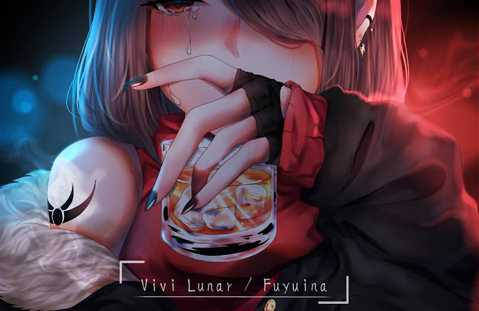
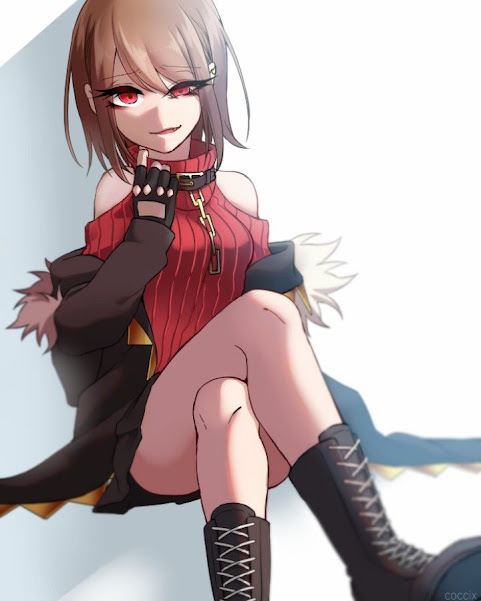

<!-- 🥀 ReactionaryGod's profile · crimson / black / gold 🥀 -->

<p align="center">
  
</p>

<p align="center">
  
</p>

<p align="center">
  <a href="https://github.com/ReactionaryGod">
    
  </a>
</p>

<p align="center">
  
  
  
</p>

---

## 🥀 「 自己紹介 」 About me



```yaml
name:       Bùi béo
alias:      ReactionaryGod
class:      Student Developer   (Lv. 1 → ∞)
element:    🐍 Python
side_quest: 🛠️ game modding
palette:    crimson · black · gold
status:     「 currently grinding 」 code, tetris
            & a very long anime backlog
motto: >
  if tetris teaches me anything it's that
  errors pile up and accomplishments disappear
```

> *Red eyes don't lie.* 🖤 Poke around my repos or drop a hi.

<br clear="right"/>

---

## ⛓️ 「 武器 」 Arsenal

<p align="center">
  
</p>

---

## 🍷 「 ステータス 」 Power level

<p align="center">
  
  
</p>

<p align="center">
  
</p>

<p align="center">
  <b>⚔️ Training Arc ⚔️</b><br/><br/>
  
</p>

---

## 📜 「 クエスト 」 Quest log

| | Quest | Status |
|:-:|:--|:-:|
| 📊 | [**Do_An_KTLT_Churn_Prediction**](https://github.com/ReactionaryGod/Do_An_KTLT_Churn_Prediction) · predicting customer churn with Python | ✅ Cleared |
| 🛠️ | Game modding experiments | 🔥 In progress |
| 🧱 | Beat my Tetris high score | 💀 Errors piling up |

---

## 🖤 「 推し 」 My waifu

<p align="center">
  
  &nbsp;
  
</p>

<p align="center"><sub>🎨 Art by <b>Vivi Lunar / Fuyuina</b> and <b>COCCIX</b>. All credit to the artists.</sub></p>

---

<p align="center">
  <i>「 諦めないで 」 · don't give up, the next episode is always better</i><br/>
  <sub>🥀 thanks for stopping by 🥀</sub>
</p>

<p align="center">
  
</p>
